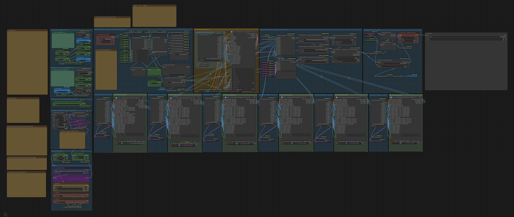

# MiniMax H3 – All-in-One Video Studio

### All-in-One ComfyUI Workflow for MiniMax H3

**REF2VA / T2VA / I2V / FLF2VA | 7-Clip Generation | Part Continuation | Face Refine | Latent Upscale | Audio Refine**

MiniMax H3の4つの動画生成方式を統合した、ComfyUI用オールインワン・ワークフローです。

専用の **H3 Scene Editor** で各Clipの設定を管理し、生成方式を自動切替できます。

最大7Clipの連続生成に加え、Part間のMotion Contextを引き継ぐことで、さらに長い動画制作にも対応しています。



---

## 主な特徴 / Features

- **4つの生成方式を自動切替**
  - REF2VA — Reference to Video + Audio
  - T2VA — Text to Video + Audio
  - I2V（I2VA）— Image to Video + Audio
  - FLF2VA — First / Last Frame to Video + Audio

- **最大7Clip連続生成**
  - 各Clipの動画尺・プロンプトを個別設定
  - `Use Clip Total` で使用Clip数を指定
  - Clip間の映像・音声を連結

- **Part Continuation**
  - NEW / CONTINUEの切替
  - MP4 TailとNative AV LatentによるMotion Context引き継ぎ
  - 複数Partを連結した長尺動画制作

- **H3 Scene Editor**
  - 各Clipのプロンプト・参照画像・動画尺を管理
  - 生成方式を自動切替
  - 外部プロンプトガイドと組み合わせたScene制作

- **Face Refine + FaceAutoBypass**
  - 小さく映った人物の顔を補正
  - 顔が検出されないClipでは自動バイパス
  - 全Clip共通の管理パネル

- **Latent Upscale + Pass2 Refine**
  - Video Latentを直接アップスケール
  - Pass2で追加Refine
  - 共通管理パネルによる倍率・Steps・Denoise調整

- **Audio Refine**
  - 生成済みのVideo Latentを維持し、Audio Latentに追加のRefine処理
  - 高速生成時の音声ノイズや不自然さの改善を目指す
  - ステップ数とAudio Denoiseで処理を調整

- **Audio Alignment**
  - Clip間の音声長を調整
  - 映像・音声の同期を維持するための補正処理

---

## 1. 必要環境 / Requirements

- MiniMax H3対応のComfyUI
- NVIDIA GPU（RTX Video Super Resolution使用時）
- Python / PyTorch / CUDAが正常に動作する環境
- 必要なMiniMax H3モデルとカスタムノード

本ワークフローは、**RTX 3060 12GB / システムRAM 64GB** の環境で開発・検証しています。

**インストールから初回生成までの流れ：** 必須カスタムノード導入 → 必要モデル配置 → ワークフローJSON読み込み → H3 Scene Editor設定 → Part1（NEW）で生成。

生成速度や使用可能な解像度は、GPU・VRAM・モデル・設定によって異なります。

---

## 2. ワークフローのダウンロード

このRepositoryにある以下のファイルをダウンロードしてください。

**Workflow JSON**

`MiniMax H3 – All-in-One Video Studio.json`

GitHubのファイル一覧からJSONを開き、右上のダウンロード機能を使用してください。

ダウンロードしたJSONをComfyUIの画面へドラッグ＆ドロップすると、ワークフローを読み込めます。

**初回の確認：** ワークフロー読み込み時にMissing Nodeが出る場合は、以下の必須カスタムノードのインストールとComfyUI再起動を確認してください。

---

## 3. 必須カスタムノード / Required Custom Nodes

### ① ComfyUI Managerからインストール

**ComfyUI-KJNodes**

Repository: [kijai/ComfyUI-KJNodes](https://github.com/kijai/ComfyUI-KJNodes)

Set/GetノードやAttention関連の処理に使用します。

### ② Git cloneで手動インストール

### Windows / venv環境での準備（最初に1回だけ）

**ComfyUI本体のフォルダ**でコマンドプロンプトを開き、以下を順番に実行します。

```bat
venv\Scripts\activate
cd custom_nodes
```

以降の `git clone` と依存パッケージのインストールコマンドは、**すべて `custom_nodes` フォルダで実行**してください。各コマンドの後も同じ場所から続けられます。

- `git clone` 自体にvenvは不要ですが、先に有効化しても問題ありません。
- `python -m pip` は、必ずComfyUIが実際に使用するPython環境で実行してください。
- ComfyUI Portable版などvenvを使用しない環境では、上記の有効化コマンドを使わず、その環境のPythonで依存パッケージをインストールしてください。

#### ComfyUI_Nvidia_VFX_Nodes

Repository: [Comfy-Org/ComfyUI_Nvidia_VFX_Nodes](https://github.com/Comfy-Org/ComfyUI_Nvidia_VFX_Nodes)

```bat
git clone https://github.com/Comfy-Org/ComfyUI_Nvidia_VFX_Nodes.git
python -m pip install -r ComfyUI_Nvidia_VFX_Nodes\requirements.txt
```

RTX Video Super Resolutionによる動画のアップスケールに使用します。NVIDIA RTX GPUが必要です。現在ComfyUI Managerでインストールエラーが発生するため、手動で導入します。

#### ComfyUI-MiniMax-H3-Integrated

Repository: [fukkun2705-commits/ComfyUI-MiniMax-H3-Integrated](https://github.com/fukkun2705-commits/ComfyUI-MiniMax-H3-Integrated)

```bat
git clone https://github.com/fukkun2705-commits/ComfyUI-MiniMax-H3-Integrated.git
python -m pip install -r ComfyUI-MiniMax-H3-Integrated\requirements.txt
```

本ワークフロー専用の統合カスタムノードです。

#### ComfyUI-H3-Motion-Context-MultiRef

Repository: [seitanism/ComfyUI-H3-Motion-Context-MultiRef](https://github.com/seitanism/ComfyUI-H3-Motion-Context-MultiRef)

```bat
git clone https://github.com/seitanism/ComfyUI-H3-Motion-Context-MultiRef.git
```

Clip間・Part間で映像と音声のMotion Contextを引き継ぎます。

#### ComfyUI-H3-FaceRefine

Repository: [Carasibana/ComfyUI-H3-FaceRefine](https://github.com/Carasibana/ComfyUI-H3-FaceRefine)

```bat
git clone https://github.com/Carasibana/ComfyUI-H3-FaceRefine.git
python -m pip install -r ComfyUI-H3-FaceRefine\requirements.txt
```

遠景などで小さく映った人物の顔を補正します。FaceAutoBypassは統合カスタムノードに含まれるため、個別インストールは不要です。

#### Comfyui_Minimax_h3_latent_Upscaler

Repository: [LBH-123-AI/Comfyui_Minimax_h3_latent_Upscaler](https://github.com/LBH-123-AI/Comfyui_Minimax_h3_latent_Upscaler)

```bat
git clone https://github.com/LBH-123-AI/Comfyui_Minimax_h3_latent_Upscaler.git
```

Video Latentをアップスケールし、Pass2でRefineします。

Latent Upscaler用モデル：`minimax_h3_latent_upscaler_3d_conv_v1_fp16.safetensors`

配置先：`ComfyUI/models/latent_upscale_models/`（共有Models環境では実際の検索パスに合わせてください）。

#### ComfyUI-H3-AudioRefine

Repository: [Adudeguyman/ComfyUI-H3-AudioRefine](https://github.com/Adudeguyman/ComfyUI-H3-AudioRefine)

```bat
git clone https://github.com/Adudeguyman/ComfyUI-H3-AudioRefine.git
```

映像を維持しながら、音声のみ追加のRefine処理を行います。

### ③ インストール後の確認

全カスタムノードの導入後、ComfyUIを再起動してください。起動ログの `IMPORT FAILED` とワークフロー読み込み時の `Missing Node` がないことを確認します。

※ 依存パッケージがすでに導入されている場合、`Requirement already satisfied` は正常な表示です。

---

## 4. 必要モデル / Required Models

MiniMax H3の動画生成に必要なモデルを、ComfyUIが参照するモデルフォルダへ配置してください。

### Diffusion Model

使用例：

```text
minimax_h3_fused_refdelta_r1024_turbo8_mystic07_int8_convrot.safetensors
```

配置先：

```text
ComfyUI/models/diffusion_models/
```

### Text Encoder

使用例：

```text
qwen3vl_32b_minimax_h3_nvfp4_awq.safetensors
```

配置先：

```text
ComfyUI/models/text_encoders/
```

### Video / Audio VAE

```text
minimax_h3_video_vae_int8_convrot.safetensors
minimax_h3_audio_vae_fp32.safetensors
```

配置先：

```text
ComfyUI/models/vae/
```

### Latent Upscale Model

```text
minimax_h3_latent_upscaler_3d_conv_v1_fp16.safetensors
```

配置先：

```text
ComfyUI/models/latent_upscale_models/
```

### Face Refine Detector

Face Refine用の顔検出モデルが必要です。

使用例：

```text
face_yolov8m.pt
```

使用するカスタムノードが参照できるUltralyticsモデルフォルダへ配置してください。

**注意：**

- モデルのダウンロード元や利用条件を確認してください。
- モデルファイルは、このRepositoryには含まれていません。
- Stability Matrixなどで共有Modelsを使用する場合は、実際のモデル検索パスに合わせて配置してください。
- 使用するDiffusionモデルによっては、生成方式に対応したモデルへの変更が必要です。

---

## 5. 生成方式 / Generation Modes

生成方式は **H3 Scene Editor** の `generation_mode` で設定します。

| Mode | 概要 |
|---|---|
| REF2VA | 参照画像・動画・音声を使用 |
| T2VA | テキストから映像と音声を生成 |
| I2V（I2VA） | 開始画像を指定 |
| FLF2VA | 開始画像・終了画像を指定 |

Conditioningはワークフロー内部で自動切替されます。

生成方式はプロジェクト単位の共通設定です。同一Part内で異なる方式を混在させる構成ではありません。

---

## 6. 基本操作 / How to Use
### H3 Scene Editorの起動方法

ComfyUIを起動した状態で、Webブラウザから以下のURLにアクセスしてください。

**H3 Scene Editor：**

http://127.0.0.1:8188/h3-scene-editor

H3 Scene Editorでは、生成方式（REF2VA / T2VA / I2V / FLF2VA）の選択、各Clipの動画尺、参照画像、プロンプトを設定できます。

設定後は、必ず **「全Clipを保存」** を押してからComfyUIで動画生成を実行してください。

※ `8188` はComfyUIの標準的なポート番号です。異なるポートで起動している場合は、URLのポート番号を変更してください。Scene Editorが表示されない場合は、統合カスタムノードの導入とComfyUIの起動ログを確認してください。

### Part1 — NEW（最初のPart）

**H3 Scene Editor**

1. `H3 Scene Editor` を開きます。
2. Generation Modeを選択します。
3. 各ClipのDuration・参照画像・Promptを設定します。
4. **「全Clipを保存」** を押します。

**ComfyUI**

1. `Resolution Selector (Size)` でアスペクト比と解像度を設定します。`multiple` は通常32を使用します。
2. `Part Mode` を **NEW** に設定します。
3. `Use Clip Total` で使用するClip数（1～7）を指定します。
4. モデルの選択・参照画像の指定が正しいことを確認し、動画生成を実行します。
5. 完成MP4とNative AV Latentが保存されたことを確認します。

**最初は1Clipの短い動画で動作確認するのがおすすめです。** 問題がなければ2Clip以上に増やしてください。

### Part2 — CONTINUE

**H3 Scene Editor**

1. Part2の各Clip設定を作成します。
2. **「全Clipを保存」** を押します。

**ComfyUI**

1. `Part Mode` を **CONTINUE** に変更します。
2. `Use Clip Total` で使用するClip数を指定します。
3. `PART2 INPUT — Load Part1 MP4 Tail` にPart1の完成MP4を指定します。
4. `PART CONTEXT — Load latest AV Latent` がPart1のNative AV Latentを参照していることを確認します。
5. 動画生成を実行します。

### Part3以降 — CONTINUE

Part2と同じ操作を繰り返します。**解像度はPart1と同じ設定を引き継ぎます。**

MP4 Tailには**直前のPartの完成MP4**を指定してください。

Part3以降も、同じPart継続用入力ノードを使用します。

---

## 7. Motion Context / Part Continuation

Part継続では、前Partの映像と音声の情報を引き継ぎます。

主に以下の情報を利用します。

- 前Partの完成MP4の末尾フレーム
- 前Partから保存されたNative AV Latent

**MP4 Tail推奨値**

```text
tail_frames = 22
```

24fpsで約0.92秒に相当します。

この値を変更すると、Part間の映像の連続性や最終動画尺、音声同期に影響する可能性があります。通常は22のまま使用してください。

**Native AV Latentについて**

保存先：

```text
h3_part_context/integrated_parts/last_clip
```

読み込みフォルダ：

```text
h3_part_context/integrated_parts
```

通常、CONTINUEでは指定フォルダ内の最新AV Latentを読み込みます。

**重要：MP4とNative AV Latentは、同じPart・同じ生成回のものを使用してください。**

同じフォルダで別プロジェクトを生成したり、過去のPartを再生成した場合、意図しないAV Latentを読み込む可能性があります。

---

## 8. Face Refine / FaceAutoBypass

Face Refineは、小さく映った人物の顔を補正する機能です。

FaceAutoBypassにより、顔が検出されないClipではFace Refineを自動的にスキップできます。

推奨初期値：

```text
Use Face Refine      = ON
FR Steps             = 4
FR Denoise           = 0.4
FR Canvas            = 768
FR Confidence        = 0.35
FR Crop Factor       = 2.5
FR Identity Threshold = 0.28
```

顔検出の結果によっては、誤検出・検出漏れが発生する場合があります。

---

## 9. Latent Upscale / Pass2 Refine

MiniMax H3のPass1で生成したVideo Latentを直接アップスケールし、その後Pass2でRefine生成を行います。

```text
MiniMax H3 Pass1
       ↓
Video Latent Upscale
       ↓
Pass2 Refine
       ↓
VAE Decode
```

推奨初期値：

```text
Use Latent Upscale / Pass2 = ON
Upscale Scale              = 1.6
Pass2 Steps                = 2
Pass2 Denoise              = 0.18
Pass2 Sampler              = euler
```

アップスケール倍率を上げると、VRAM使用量や生成時間も増加します。

また、内部のLatentサイズ調整により、指定倍率と最終出力解像度が厳密には一致しない場合があります。

---

## 10. Audio Refine

Audio Refineは、MiniMax H3で生成した**映像を維持しながら、音声だけに追加のRefine処理**を行う機能です。

4Step Turboなどの高速生成で、映像は十分な品質でも音声にノイズや不自然さが残る場合に、追加の音声生成ステップで改善を図ります。

### 処理の流れ

```text
MiniMax H3 Pass1（映像＋音声）
          ↓
      Audio Refine
      ├─ Video：維持
      └─ Audio：追加Refine
          ↓
       VAE Decode
```

- `Steps`：音声側に追加するRefineステップ数
- `Audio Denoise`：音声を再生成する強度。値を上げるほど変化が大きくなります
- 映像と音声の長さ・同期を調整する **Audio Alignment** とは別の機能です

追加処理には生成時間がかかり、結果はプロンプトやモデルの設定によって変化します。

詳しいノード仕様：[ComfyUI-H3-AudioRefine](https://github.com/Adudeguyman/ComfyUI-H3-AudioRefine)

---

## 11. 注意事項 / Notes

- ComfyUIと必要なカスタムノードを導入してからワークフローを読み込んでください。
- JSON内で指定されているモデル名やファイルパスは、使用環境に合わせて変更してください。
- Scene Editorの設定変更後は、必ず「全Clipを保存」を押してください。
- 最大7Clipの連続生成に対応していますが、VRAM容量や生成設定によって処理時間は変わります。
- REF2VAでは参照画像とプロンプトの整合性が再現結果に影響することがあります。
- BGMなど生成音声の品質は、プロンプトや生成条件によって変化します。
- Motion Contextによる連続性の維持は、すべての生成結果で完全なシームレス性を保証するものではありません。
- 新しい統合カスタムノードを導入した環境では、Missing NodeやImport Failedがないことを確認してください。

---

## 12. Credits / Acknowledgements

このワークフローはComfyUIと、以下の外部カスタムノードを利用しています。

- [ComfyUI](https://github.com/Comfy-Org/ComfyUI)
- [ComfyUI-KJNodes](https://github.com/kijai/ComfyUI-KJNodes)
- [ComfyUI_Nvidia_VFX_Nodes](https://github.com/Comfy-Org/ComfyUI_Nvidia_VFX_Nodes)
- [ComfyUI-H3-Motion-Context-MultiRef](https://github.com/seitanism/ComfyUI-H3-Motion-Context-MultiRef)
- [ComfyUI-H3-FaceRefine](https://github.com/Carasibana/ComfyUI-H3-FaceRefine)
- [MiniMax H3 Latent Upscaler](https://github.com/LBH-123-AI/Comfyui_Minimax_h3_latent_Upscaler)
- [ComfyUI-H3-AudioRefine](https://github.com/Adudeguyman/ComfyUI-H3-AudioRefine)

ワークフロー専用の統合カスタムノード：

[ComfyUI-MiniMax-H3-Integrated](https://github.com/fukkun2705-commits/ComfyUI-MiniMax-H3-Integrated)

各プロジェクトの開発者およびコントリビューターに感謝します。

---

## License

MIT License

詳細はRepository内の `LICENSE` を参照してください。
